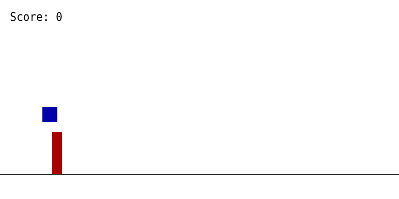
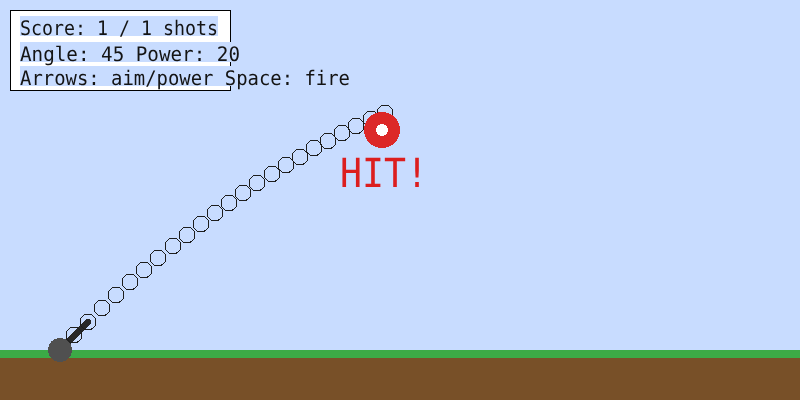
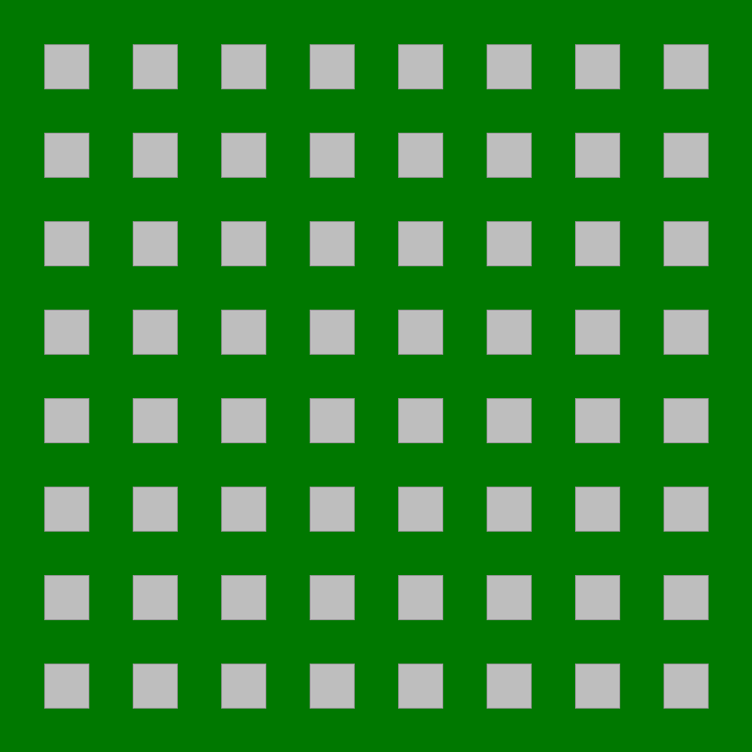
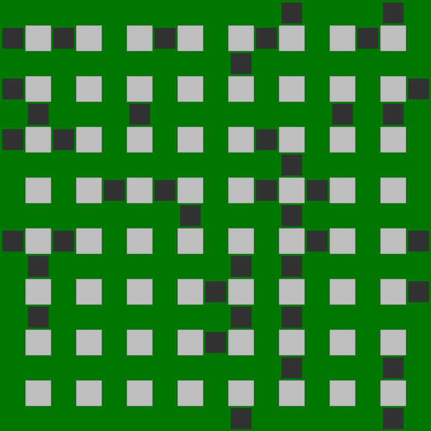
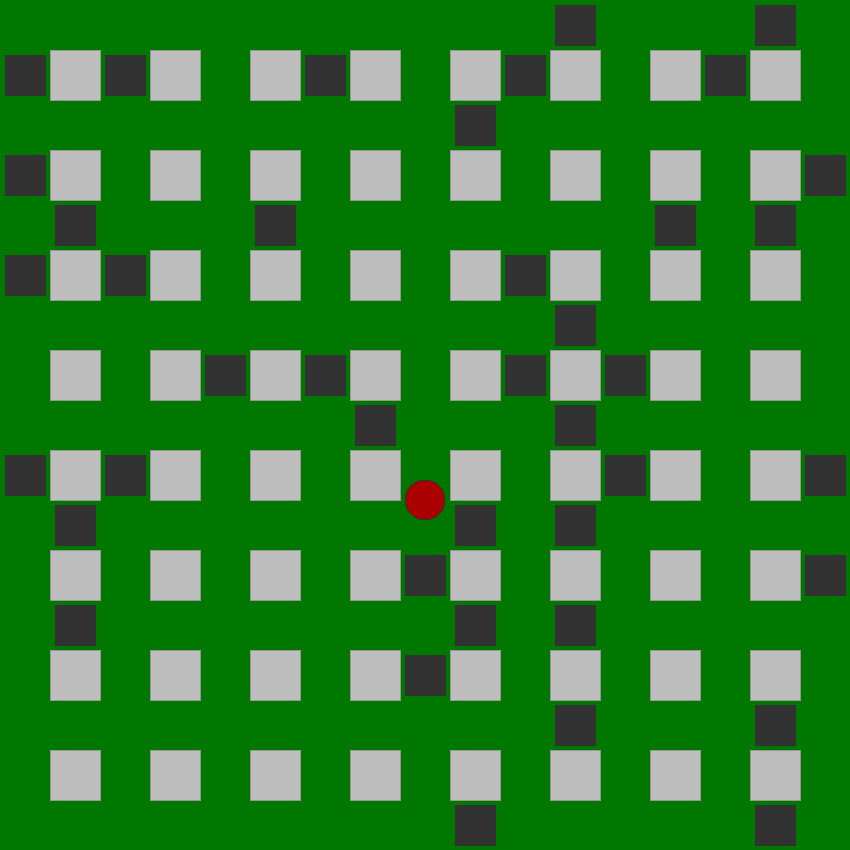
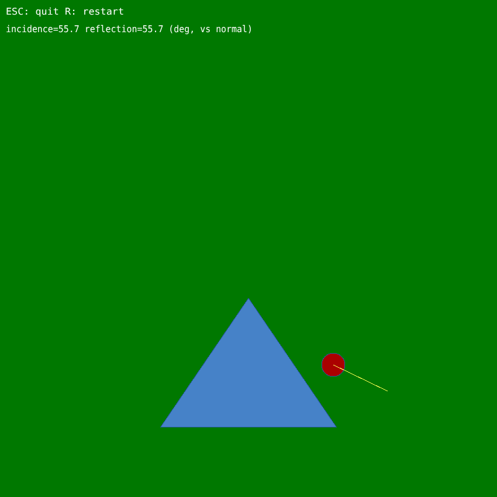
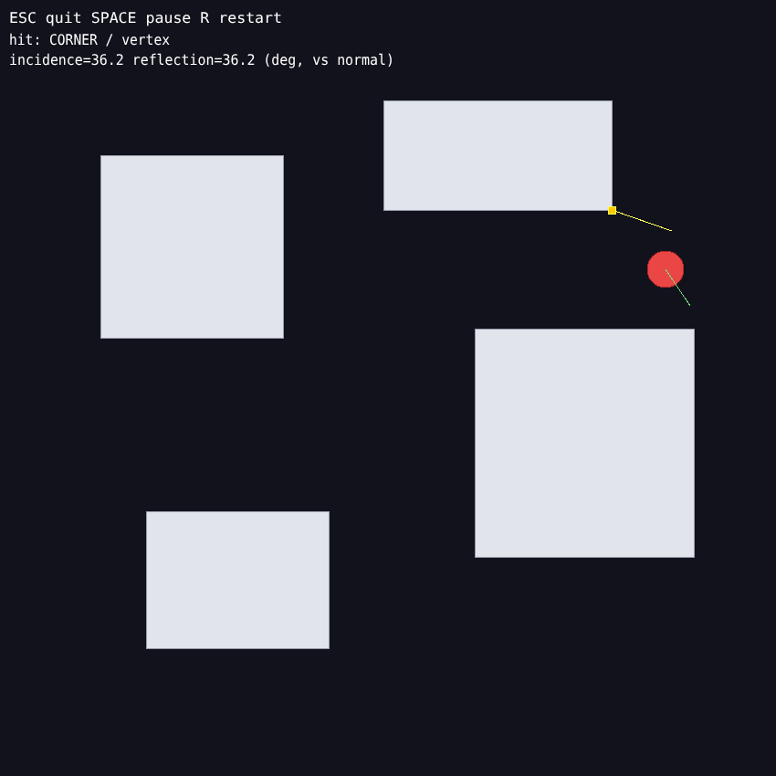

# 🖼️ Game Gallery

Every game built in the course, as a picture and as code. Click **Show the code** under a picture to read the full program.

> The pictures are made by running the real code through a small EasyX stand-in, so they show exactly what each program draws. See [tools/easyx-snapshot](tools/easyx-snapshot/) to regenerate them.

| | | |
|---|---|---|
| [<br>**Hello Shapes**](#hello-shapes) | [<br>**Jump Runner**](#jump-runner) | [<br>**Balloon Archery**](#balloon-archery) |
| [<br>**Cannon Shooter**](#cannon-shooter) | [<br>**Bomberman, step 1: concrete map**](#bomberman-step-1-concrete-map) | [<br>**Bomberman, step 2: random bricks**](#bomberman-step-2-random-bricks) |
| [<br>**Bomberman, step 3: player control**](#bomberman-step-3-player-control) | [<br>**Triangle Bounce**](#triangle-bounce) | [<br>**Circle vs. Rectangle**](#circle-vs-rectangle) |

---

## Hello Shapes


A night scene drawn with lines, circles and rectangles. Press a key and a ball starts bouncing between the walls.

**Controls:** Any key: animate / quit  
**Lesson:** [01-drawing-on-screen](lessons/01-drawing-on-screen/) · **File:** [`hello_shapes.cpp`](lessons/01-drawing-on-screen/hello_shapes.cpp)

<details><summary><b>Show the code</b></summary>

```cpp
// hello_shapes.cpp -- Lesson 1: open a window, use colors, draw shapes, then animate one.
// Compile: g++ hello_shapes.cpp -o hello_shapes.exe -leasyx -lgdi32 -lole32 -luuid
#include <conio.h>
#include <graphics.h>
#include <windows.h>

#define WIDTH 640
#define HEIGHT 480

int main()
{
    initgraph(WIDTH, HEIGHT);           // 1. Create the game screen

    // ---- Part A: a static picture ----
    setbkcolor(RGB(30, 30, 60));        // 2. Background color (R, G, B each 0~255)
    cleardevice();                      //    Repaint the whole screen with it

    setlinecolor(WHITE);                // 3. Outline color
    line(0, 400, WIDTH, 400);           //    The ground

    setfillcolor(RGB(255, 200, 0));     // 4. Fill color
    solidcircle(540, 80, 40);           //    A sun (filled, no outline)

    setfillcolor(RGB(200, 60, 60));
    fillrectangle(100, 300, 220, 400);  //    A house (filled + outline)

    setlinecolor(RGB(0, 200, 255));
    circle(160, 260, 30);               //    An empty circle

    settextcolor(WHITE);
    setbkmode(TRANSPARENT);             //    Text without a background box
    outtextxy(10, 10, _T("Static picture. Press any key to animate..."));

    _getch();                           // Wait for a key

    // ---- Part B: animation = draw, wait, clear, move, repeat ----
    int x = 40, y = 360, r = 30;
    int vx = 4;

    BeginBatchDraw();                   // Draw off-screen first: no flicker
    while (!_kbhit())                   // Run until a key is pressed
    {
        cleardevice();                  // Erase the previous frame

        setlinecolor(WHITE);
        line(0, 400, WIDTH, 400);
        setfillcolor(RGB(255, 80, 80));
        solidcircle(x, y, r);
        outtextxy(10, 10, _T("Animation. Press any key to quit."));

        x += vx;                        // Move
        if (x > WIDTH - r || x < r)     // Hit a wall? turn around
            vx = -vx;

        FlushBatchDraw();               // Show the finished frame
        Sleep(16);                      // Wait ~16 ms (about 60 frames per second)
    }
    EndBatchDraw();

    closegraph();
    return 0;
}
```

</details>

---

## Jump Runner


Jump over red pillars of random height and speed. One touch and it is game over.

**Controls:** Space: jump  
**Lesson:** [02-game-loop-runner](lessons/02-game-loop-runner/) · **File:** [`runner_jump.cpp`](lessons/02-game-loop-runner/runner_jump.cpp)

<details><summary><b>Show the code</b></summary>

```cpp
#include <graphics.h>
#include <conio.h>
#include <windows.h>
#include <stdio.h>
#include <stdlib.h>
#include <time.h>

#define WIDTH 800
#define HEIGHT 400
#define GROUND_Y 350

int main()
{
    srand((unsigned)time(NULL));

    initgraph(WIDTH, HEIGHT);
    BeginBatchDraw();

    // ---- Ball (player) ----
    int x_ball = 100;
    double y_ball = GROUND_Y - 15;   // resting on the ground
    int r = 15;                       // ball is treated as a square, r = half its size
    double vy = 0;                    // vertical speed
    double gravity = 1.0;
    bool jumping = false;

    // ---- Pillar (obstacle) ----
    int pillar_width = 20;
    int x_pillar = WIDTH;
    int pillar_height = rand() % 60 + 30;   // random height 30-90
    int pillar_speed = rand() % 5 + 4;      // random speed 4-9
    bool counted = false;                    // scored for this pillar yet?

    int score = 0;
    bool gameOver = false;

    while (!gameOver)
    {
        // ---- Input ----
        if ((GetAsyncKeyState(VK_SPACE) & 0x8000) && !jumping)
        {
            jumping = true;
            vy = -14;
        }

        // ---- Ball physics ----
        if (jumping)
        {
            y_ball += vy;
            vy += gravity;
            if (y_ball >= GROUND_Y - r)
            {
                y_ball = GROUND_Y - r;
                vy = 0;
                jumping = false;
            }
        }

        // ---- Move pillar ----
        x_pillar -= pillar_speed;
        if (x_pillar + pillar_width < 0)
        {
            x_pillar = WIDTH;
            pillar_height = rand() % 60 + 30;
            pillar_speed = rand() % 5 + 4;
            counted = false;
        }

        // ---- Score when pillar fully passes the ball ----
        if (!counted && x_pillar + pillar_width < x_ball - r)
        {
            score++;
            counted = true;
        }

        // ---- Collision detection ----
        int pillar_top = GROUND_Y - pillar_height;
        bool overlapX = (x_ball + r > x_pillar) && (x_ball - r < x_pillar + pillar_width);
        bool overlapY = (y_ball + r > pillar_top);   // ball hasn't jumped above the pillar
        if (overlapX && overlapY)
        {
            gameOver = true;
        }

        // ---- Draw ----
        setbkcolor(WHITE);
        cleardevice();

        setlinecolor(BLACK);
        line(0, GROUND_Y, WIDTH, GROUND_Y);

        setfillcolor(BLUE);
        solidrectangle(x_ball - r, (int)y_ball - r, x_ball + r, (int)y_ball + r);

        setfillcolor(RED);
        solidrectangle(x_pillar, pillar_top, x_pillar + pillar_width, GROUND_Y);

        settextcolor(BLACK);
        settextstyle(24, 0, "Consolas");
        char text[50];
        sprintf(text, "Score: %d", score);
        outtextxy(20, 20, text);

        FlushBatchDraw();
        Sleep(15);
    }

    setbkcolor(WHITE);
    cleardevice();
    settextcolor(RED);
    settextstyle(30, 0, "Consolas");
    char text2[80];
    sprintf(text2, "Game Over! Score: %d", score);
    outtextxy(WIDTH/2 - 150, HEIGHT/2, text2);
    FlushBatchDraw();

    _getch();
    EndBatchDraw();
    closegraph();
    return 0;
}
```

</details>

---

## Balloon Archery


Shoot arrows at rising balloons and the golden balloon sliding on the bar. Up to 30 arrows can fly at once.

**Controls:** Space: shoot · Esc: quit  
**Lesson:** [03-many-objects-archery](lessons/03-many-objects-archery/) · **File:** [`balloon_archery.cpp`](lessons/03-many-objects-archery/balloon_archery.cpp)

<details><summary><b>Show the code</b></summary>

```cpp
#include <graphics.h>
#include <conio.h>
#include <windows.h>
#include <stdio.h>
#include <stdlib.h>
#include <time.h>
#include <math.h>

#define WIDTH 800
#define HEIGHT 400
#define GROUND_Y 350
#define MAX_ARROWS 30
#define NUM_BALLOONS 5

struct Arrow {
    double x, y, vx, vy;
    bool active;
};

struct Balloon {
    double x, y, vx, vy;
    int r;
    bool onBar;
    bool active;
    COLORREF color;
};

void drawClouds()
{
    setfillcolor(RGB(255, 255, 255));
    int cx[3] = {150, 420, 650};
    int cy[3] = {60, 40, 70};
    for (int i = 0; i < 3; i++)
    {
        solidcircle(cx[i], cy[i], 16);
        solidcircle(cx[i] + 18, cy[i] + 5, 20);
        solidcircle(cx[i] - 18, cy[i] + 5, 14);
    }
}

int main()
{
    srand((unsigned)time(NULL));
    initgraph(WIDTH, HEIGHT);
    BeginBatchDraw();

    int px = 50, py = GROUND_Y;

    Arrow arrows[MAX_ARROWS];
    for (int i = 0; i < MAX_ARROWS; i++) arrows[i].active = false;

    COLORREF palette[5] = {
        RGB(235, 64, 52), RGB(240, 160, 30), RGB(180, 70, 220),
        RGB(40, 150, 230), RGB(250, 200, 30)
    };

    Balloon balloons[NUM_BALLOONS];
    for (int i = 0; i < NUM_BALLOONS - 1; i++)
    {
        balloons[i].x = rand() % 600 + 100;
        balloons[i].y = GROUND_Y - (rand() % 250 + 50);
        balloons[i].vx = 0;
        balloons[i].vy = -(rand() % 2 + 1);
        balloons[i].r = 15;
        balloons[i].onBar = false;
        balloons[i].active = true;
        balloons[i].color = palette[i];
    }
    int barY = 80, barLeft = 120, barRight = 700;
    balloons[NUM_BALLOONS - 1].x = barLeft;
    balloons[NUM_BALLOONS - 1].y = barY - 15;
    balloons[NUM_BALLOONS - 1].vx = 3;
    balloons[NUM_BALLOONS - 1].vy = 0;
    balloons[NUM_BALLOONS - 1].r = 15;
    balloons[NUM_BALLOONS - 1].onBar = true;
    balloons[NUM_BALLOONS - 1].active = true;
    balloons[NUM_BALLOONS - 1].color = palette[4];

    int score = 0;
    bool prevSpace = false;
    bool running = true;

    while (running)
    {
        if (GetAsyncKeyState(VK_ESCAPE) & 0x8000) running = false;

        bool spaceNow = (GetAsyncKeyState(VK_SPACE) & 0x8000) != 0;
        if (spaceNow && !prevSpace)
        {
            for (int i = 0; i < MAX_ARROWS; i++)
            {
                if (!arrows[i].active)
                {
                    arrows[i].x = px + 15;
                    arrows[i].y = py - 15;
                    arrows[i].vx = 12;
                    arrows[i].vy = -7;
                    arrows[i].active = true;
                    break;
                }
            }
        }
        prevSpace = spaceNow;

        for (int i = 0; i < MAX_ARROWS; i++)
        {
            if (!arrows[i].active) continue;
            arrows[i].x += arrows[i].vx;
            arrows[i].y += arrows[i].vy;
            if (arrows[i].x > WIDTH || arrows[i].y < 0) arrows[i].active = false;
        }

        for (int i = 0; i < NUM_BALLOONS; i++)
        {
            if (!balloons[i].active) continue;
            if (balloons[i].onBar)
            {
                balloons[i].x += balloons[i].vx;
                if (balloons[i].x < barLeft || balloons[i].x > barRight)
                    balloons[i].vx = -balloons[i].vx;
            }
            else
            {
                balloons[i].y += balloons[i].vy;
                if (balloons[i].y < 0)
                {
                    balloons[i].x = rand() % 600 + 100;
                    balloons[i].y = GROUND_Y;
                    balloons[i].vy = -(rand() % 2 + 1);
                }
            }
        }

        for (int i = 0; i < MAX_ARROWS; i++)
        {
            if (!arrows[i].active) continue;
            for (int j = 0; j < NUM_BALLOONS; j++)
            {
                if (!balloons[j].active) continue;
                double dx = arrows[i].x - balloons[j].x;
                double dy = arrows[i].y - balloons[j].y;
                double dist = sqrt(dx * dx + dy * dy);
                if (dist < balloons[j].r + 4)
                {
                    arrows[i].active = false;
                    score++;
                    if (balloons[j].onBar)
                        balloons[j].x = barLeft;
                    else
                    {
                        balloons[j].x = rand() % 600 + 100;
                        balloons[j].y = GROUND_Y;
                        balloons[j].vy = -(rand() % 2 + 1);
                    }
                }
            }
        }

        // ---- Draw background ----
        setbkcolor(RGB(135, 206, 250));   // sky blue
        cleardevice();
        drawClouds();

        // ground: dirt band + grass strip on top
        setfillcolor(RGB(139, 90, 43));
        solidrectangle(0, GROUND_Y, WIDTH, HEIGHT);
        setfillcolor(RGB(50, 160, 60));
        solidrectangle(0, GROUND_Y, WIDTH, GROUND_Y + 10);

        // wooden bar
        setfillcolor(RGB(120, 70, 30));
        solidrectangle(barLeft - 15, barY - 6, barRight + 15, barY + 6);

        // player: body + bow arc
        setfillcolor(RGB(70, 130, 180));
        solidcircle(px, py - 20, 14);
        setlinecolor(RGB(90, 60, 30));
        setlinestyle(PS_SOLID, 3);
        arc(px - 5, py - 40, px + 25, py, 300, 60);

        // arrows: shaft + triangular head
        for (int i = 0; i < MAX_ARROWS; i++)
        {
            if (!arrows[i].active) continue;
            int hx = (int)arrows[i].x, hy = (int)arrows[i].y;
            int tx = (int)(arrows[i].x - arrows[i].vx), ty = (int)(arrows[i].y - arrows[i].vy);
            setlinecolor(RGB(90, 60, 30));
            setlinestyle(PS_SOLID, 2);
            line(tx, ty, hx, hy);
            setfillcolor(RGB(60, 60, 60));
            solidcircle(hx, hy, 3);
        }

        // balloons: body + highlight + string
        for (int i = 0; i < NUM_BALLOONS; i++)
        {
            if (!balloons[i].active) continue;
            int bx = (int)balloons[i].x, by = (int)balloons[i].y;
            setlinecolor(RGB(120, 120, 120));
            setlinestyle(PS_SOLID, 1);
            line(bx, by + balloons[i].r, bx, by + balloons[i].r + 18);
            setfillcolor(balloons[i].color);
            solidcircle(bx, by, balloons[i].r);
            setfillcolor(RGB(255, 255, 255));
            solidcircle(bx - 5, by - 5, 4);
        }

        // score panel
        setfillcolor(RGB(255, 255, 255));
        solidrectangle(10, 10, 170, 45);
        setlinecolor(RGB(0, 0, 0));
        rectangle(10, 10, 170, 45);
        settextcolor(RGB(20, 20, 20));
        settextstyle(22, 0, "Consolas");
        char text[50];
        sprintf(text, "Score: %d", score);
        outtextxy(20, 16, text);

        FlushBatchDraw();
        Sleep(15);
    }

    EndBatchDraw();
    closegraph();
    return 0;
}
```

</details>

---

## Cannon Shooter


Aim, set the power and fire at a moving target. The chain of circles shows the ball's parabola.

**Controls:** ← →: aim · ↑ ↓: power · Space: fire · Esc: quit  
**Lesson:** [04-projectile-cannon](lessons/04-projectile-cannon/) · **File:** [`cannon_projectile.cpp`](lessons/04-projectile-cannon/cannon_projectile.cpp)

<details><summary><b>Show the code</b></summary>

```cpp
#include <graphics.h>
#include <conio.h>
#include <windows.h>
#include <stdio.h>
#include <stdlib.h>
#include <time.h>
#include <math.h>

#define WIDTH 800
#define HEIGHT 400
#define GROUND_Y 350
#define PI 3.14159265
#define MAX_TRAIL 80

int main()
{
    srand((unsigned)time(NULL));
    initgraph(WIDTH, HEIGHT);
    BeginBatchDraw();

    // ---- Cannon ----
    int cannonX = 60, cannonY = GROUND_Y;
    double angle = 45;
    double power = 20;

    // ---- Ball in flight ----
    bool ballFlying = false;
    double bx, by, bvx, bvy;
    double gravity = 0.35;
    int ballR = 8;

    // ---- Trail of circles along the flight path ----
    double trailX[MAX_TRAIL], trailY[MAX_TRAIL];
    int trailCount = 0;

    // ---- Moving target ----
    double targetY = 130;
    double targetX = 400;
    double targetLeft = 300, targetRight = 700;
    double targetSpeed = rand() % 4 + 3;
    int targetR = 18;

    int score = 0;
    int shots = 0;
    int hitFlash = 0;
    bool prevSpace = false;
    bool running = true;

    while (running)
    {
        if (GetAsyncKeyState(VK_ESCAPE) & 0x8000) running = false;

        // ---- Aim controls (only while no ball is flying) ----
        if (!ballFlying)
        {
            if (GetAsyncKeyState(VK_LEFT) & 0x8000)  angle += 1;
            if (GetAsyncKeyState(VK_RIGHT) & 0x8000) angle -= 1;
            if (angle > 85) angle = 85;
            if (angle < 5) angle = 5;

            if (GetAsyncKeyState(VK_UP) & 0x8000)   power += 0.3;
            if (GetAsyncKeyState(VK_DOWN) & 0x8000) power -= 0.3;
            if (power > 35) power = 35;
            if (power < 8) power = 8;
        }

        // ---- Fire ----
        bool spaceNow = (GetAsyncKeyState(VK_SPACE) & 0x8000) != 0;
        if (spaceNow && !prevSpace && !ballFlying)
        {
            ballFlying = true;
            bx = cannonX;
            by = cannonY;
            bvx = power * cos(angle * PI / 180.0);
            bvy = -power * sin(angle * PI / 180.0);
            shots++;
            trailCount = 0;   // clear old trail for the new shot
        }
        prevSpace = spaceNow;

        // ---- Move target ----
        targetX += targetSpeed;
        if (targetX > targetRight || targetX < targetLeft)
        {
            targetSpeed = -targetSpeed;
            targetX += targetSpeed;
        }

        if (hitFlash > 0) hitFlash--;

        // ---- Move ball + collision detection ----
        if (ballFlying)
        {
            bx += bvx;
            by += bvy;
            bvy += gravity;

            // add current position to the trail (so it draws as a chain of circles)
            if (trailCount < MAX_TRAIL)
            {
                trailX[trailCount] = bx;
                trailY[trailCount] = by;
                trailCount++;
            }

            double dx = bx - targetX;
            double dy = by - targetY;
            double dist = sqrt(dx * dx + dy * dy);
            if (dist < targetR + 6)
            {
                score++;
                ballFlying = false;
                hitFlash = 30;
                Beep(1000, 100);
                targetSpeed = (rand() % 4 + 3) * (targetSpeed > 0 ? 1 : -1);
            }
            else if (by > GROUND_Y || bx > WIDTH || bx < 0)
            {
                ballFlying = false;   // missed
            }
        }

        // ---- Draw ----
        setbkcolor(RGB(200, 220, 255));
        cleardevice();

        setfillcolor(RGB(120, 80, 40));
        solidrectangle(0, GROUND_Y, WIDTH, HEIGHT);
        setfillcolor(RGB(60, 170, 70));
        solidrectangle(0, GROUND_Y, WIDTH, GROUND_Y + 8);

        // cannon barrel
        setlinecolor(RGB(40, 40, 40));
        setlinestyle(PS_SOLID, 6);
        int aimX = cannonX + (int)(40 * cos(angle * PI / 180.0));
        int aimY = cannonY - (int)(40 * sin(angle * PI / 180.0));
        line(cannonX, cannonY, aimX, aimY);
        setfillcolor(RGB(80, 80, 80));
        solidcircle(cannonX, cannonY, 12);

        // ---- Ball trail: chain of open circles, just like the sample ----
        setlinestyle(PS_SOLID, 1);
        setlinecolor(RGB(30, 30, 30));
        for (int i = 0; i < trailCount; i++)
        {
            circle((int)trailX[i], (int)trailY[i], ballR);
        }

        // target
        setfillcolor(RGB(220, 40, 40));
        solidcircle((int)targetX, (int)targetY, targetR);
        setfillcolor(RGB(255, 255, 255));
        solidcircle((int)targetX, (int)targetY, targetR / 3);

        // HUD
        setfillcolor(RGB(255, 255, 255));
        solidrectangle(10, 10, 230, 90);
        setlinecolor(RGB(0,0,0));
        rectangle(10, 10, 230, 90);
        settextcolor(RGB(20, 20, 20));
        settextstyle(20, 0, "Consolas");
        char text[80];
        sprintf(text, "Score: %d / %d shots", score, shots);
        outtextxy(20, 16, text);
        sprintf(text, "Angle: %.0f  Power: %.0f", angle, power);
        outtextxy(20, 42, text);
        outtextxy(20, 66, "Arrows: aim/power  Space: fire");

        if (hitFlash > 0)
        {
            settextcolor(RGB(220, 30, 30));
            settextstyle(40, 0, "Consolas");
            outtextxy(WIDTH / 2 - 60, 150, "HIT!");
        }

        FlushBatchDraw();
        Sleep(15);
    }

    EndBatchDraw();
    closegraph();
    return 0;
}
```

</details>

---

## Bomberman, step 1: concrete map


The permanent grey concrete blocks, placed wherever the row and column are both odd.

**Controls:** Any key: quit  
**Lesson:** [05-bomberman](lessons/05-bomberman/) · **File:** [`step1_concrete_map.cpp`](lessons/05-bomberman/step1_concrete_map.cpp)

<details><summary><b>Show the code</b></summary>

```cpp
// step1_concrete_map.cpp -- Bomberman step 1: draw the permanent concrete blocks
// Compile: g++ step1_concrete_map.cpp -o step1.exe -leasyx -lgdi32 -lole32 -luuid

//#include "stdafx.h"
#include <conio.h>
#include <graphics.h>
#include <stdlib.h>
#include <time.h>

int x = 0, y = 0;
int w = 850, h = 850;
int r = 20;
int i = 0, j = 0;
int speed = 5;
bool Box[17][17];

void DrawMap()
{
	for (i = 0; i < 17; i++) // 850 / 50 = 17
	{
		for (j = 0; j < 17; j++)
		{
			if (i % 2 != 0 && j % 2 != 0) // even number of both row and column, then we place a concrete block
			{
				int left = (i)* 50;
				int top = (j)* 50;
				int right = left + 50;
				int bottom = top + 50;
				setfillcolor(RGB(190, 190, 190)); // grey color
				setlinecolor(RGB(150, 150, 150));
				fillrectangle(left, top, right, bottom);
			}
		}
	}
}

void CreateBox()
{
	// reserve for the creation of bricks 
}

int main()
{
	initgraph(w, h);	// Create screen, 850 * 850
	setbkcolor(RGB(0, 120, 0));
	cleardevice();

	DrawMap();  //  create map with concrete blocks

	CreateBox(); //  create bricks
	
	_getch();				
	closegraph();			
	return 0;
}
```

</details>

---

## Bomberman, step 2: random bricks


Dark breakable bricks scattered at random, never on a crossroads.

**Controls:** Any key: quit  
**Lesson:** [05-bomberman](lessons/05-bomberman/) · **File:** [`step2_random_bricks.cpp`](lessons/05-bomberman/step2_random_bricks.cpp)

<details><summary><b>Show the code</b></summary>

```cpp
// step2_random_bricks.cpp -- Bomberman step 2: scatter breakable bricks at random

//#include "stdafx.h"
#include <conio.h>
#include <graphics.h>
#include <stdlib.h>
#include <time.h>

int x = 0, y = 0;
int w = 850, h = 850;
int r = 20;
int i = 0, j = 0;
int speed = 5;
bool Box[17][17];

void KeyControl()
{
  // reserve for keyboard control
}

void DrawMap()
{
	for (i = 0; i < 17; i++)
	{
		for (j = 0; j < 17; j++)
		{
			if (i % 2 != 0 && j % 2 != 0)
			{
				int left = (i)* 50;
				int top = (j)* 50;
				int right = left + 50;
				int bottom = top + 50;
				setfillcolor(RGB(190, 190, 190));
				setlinecolor(RGB(150, 150, 150));
				fillrectangle(left, top, right, bottom);
			}
			else if (Box[i][j])
			{
				int left_b = (i)* 50 + 5;
				int top_b = (j)* 50 + 5;
				int right_b = left_b + 40;
				int bottom_b = top_b + 40;
				setlinecolor(RGB(50, 50, 50));
				setfillcolor(RGB(50, 50, 50));
				fillrectangle(left_b, top_b, right_b, bottom_b);
			}
		}
	}
}

void CreateBox()
{
	for (i = 0; i < 17; i++)
	{
		for (j = 0; j < 17; j++)
		{
			if ((i+j) % 2 != 0 && rand() % 3 == 0)
				Box[i][j] = true;
			else Box[i][j] = false;
		}
	}
}

int main()
{
	initgraph(w, h);	// Create screen
	setbkcolor(RGB(0, 120, 0));
	cleardevice();
	
	srand((unsigned int)time(NULL));

	x = rand() % 9 * 100 + r + 5; //  random position
	y = rand() % 9 * 100 + r + 5;

	CreateBox();

	DrawMap();  //  create map
		
	_getch();				
	closegraph();			
	return 0;
}
```

</details>

---

## Bomberman, step 3: player control


The red player ball moves along the lanes with the arrow keys.

**Controls:** Arrow keys: move  
**Lesson:** [05-bomberman](lessons/05-bomberman/) · **File:** [`step3_player_control.cpp`](lessons/05-bomberman/step3_player_control.cpp)

<details><summary><b>Show the code</b></summary>

```cpp
// step3_player_control.cpp -- Bomberman step 3: a red ball you move with the arrow keys (entry point)
//

//#include "stdafx.h"
#include <conio.h>
#include <graphics.h>
#include <stdlib.h>
#include <time.h>
#include <winuser.h>

int x = 0, y = 0;
int w = 850, h = 850;
int r = 20;
int i = 0, j = 0;
int speed = 5;
bool Box[17][17];


void KeyControl()
{
	char userkey = _getch();        
	if (GetAsyncKeyState(VK_UP) && ((x - 25) %  100 ==0 ))   // Up
	{
		y -= speed;
		if (y <= r) y = r;
	}
	if (GetAsyncKeyState(VK_DOWN) && ((x - 25) % 100 ==0 )) // Down
	{
		y += speed;
		if (y >= w-r) y = w-r;
	}
	if (GetAsyncKeyState(VK_LEFT) && ((y - 25) % 100 == 0) ) // Left
	{
		x -= speed;
		if (x <= r) x = r;
	}
	if (GetAsyncKeyState(VK_RIGHT) && ((y - 25) % 100 == 0) ) // Right
	{
		x += speed;
		if (x >= w-r) x = w-r;
	}
}

void DrawMap()
{
	for (i = 0; i < 17; i++)
	{
		for (j = 0; j < 17; j++)
		{
			if (i % 2 != 0 && j % 2 != 0)
			{
				int left = (i)* 50;
				int top = (j)* 50;
				int right = left + 50;
				int bottom = top + 50;
				setfillcolor(RGB(190, 190, 190));
				setlinecolor(RGB(150, 150, 150));
				fillrectangle(left, top, right, bottom);
			}
			else if (Box[i][j])
			{
				int left_b = (i)* 50 + 5;
				int top_b = (j)* 50 + 5;
				int right_b = left_b + 40;
				int bottom_b = top_b + 40;
				setlinecolor(RGB(50, 50, 50));
				setfillcolor(RGB(50, 50, 50));
				fillrectangle(left_b, top_b, right_b, bottom_b);
			}
		}
	}
}

void CreateBox() // generate the bricks
{
	for (i = 0; i < 17; i++)
	{
		for (j = 0; j < 17; j++)
		{
			if ((i+j) % 2 != 0 && rand() % 3 == 0)
				Box[i][j] = true;
			else Box[i][j] = false;
		}
	}
}

int main()
{
	initgraph(w, h);	// Create screen
	
	setbkcolor(RGB(0, 120, 0));
	cleardevice();
	
	srand((unsigned int)time(NULL));

	x = rand() % 9 * 100 + r + 5; //  random position
	y = rand() % 9 * 100 + r + 5;

	CreateBox();

	BeginBatchDraw();
	while (true)
	{

		DrawMap();  //  create map

		setfillcolor(RED);

		if (_kbhit())
			KeyControl();

		fillcircle(x, y, r);

		FlushBatchDraw();
		Sleep(100);
		cleardevice();
	}

	_getch();				
	closegraph();			
	return 0;
}
```

</details>

---

## Triangle Bounce


A ball falls onto a triangle and bounces by the law of reflection. The yellow line is its velocity.

**Controls:** R: restart · Esc: quit  
**Lesson:** [06-collision-lab](lessons/06-collision-lab/) · **File:** [`triangle_bounce.cpp`](lessons/06-collision-lab/triangle_bounce.cpp)

<details><summary><b>Show the code</b></summary>

```cpp
//
// triangle_bounce.cpp -- A solid triangle at the bottom, a small circle falls freely above.
// When colliding with the triangle, it bounces following the law of incidence and reflection.
// Compile: g++ -g -std=gnu++11 triangle_bounce.cpp -o triangle_bounce.exe -leasyx -lgdi32 -lole32 -luuid
#include <conio.h>
#include <graphics.h>
#include <cmath>
#include <cstdio>

const int W = 850;   // Window width
const int H = 850;   // Window height

// ---------------- Scene Parameters ----------------
const float BASE_Y    = H - 120.0f;   // Y coordinate of triangle base
const float TRI_H     = 220.0f;       // Triangle height
const float TRI_HALF  = 150.0f;       // Half width of triangle base
const float BALL_R    = 20.0f;        // Radius of small ball
const float GRAVITY   = 0.35f;        // Gravitational acceleration per frame
const float BOUNCE_DAMP = 0.85f;      // Bounce energy retention factor (<1 means energy loss)
const float PI        = 3.14159265f;
const float START_X   = W / 2.0f + 80.0f; // Spawn position (slightly right, lands on the slope)
const float START_Y   = 40.0f;

struct Vec2 { float x, y; };

// Three vertices of triangle (pointing upward, placed at bottom)
const Vec2 TRI[3] = {
    { W / 2.0f,            BASE_Y - TRI_H }, // Top vertex
    { W / 2.0f - TRI_HALF, BASE_Y        },  // Bottom-left vertex
    { W / 2.0f + TRI_HALF, BASE_Y        }   // Bottom-right vertex
};

// Find the closest point q on line segment ab to point p(px, py)
void ClosestPointOnSeg(float px, float py, float ax, float ay, float bx, float by,
float& qx, float& qy)
{
    float dx = bx - ax, dy = by - ay;
    float len2 = dx * dx + dy * dy;
    // Clamp projection parameter t to [0,1]: get closest point on segment, not infinite line
    float t = (len2 > 0.0f) ? ((px - ax) * dx + (py - ay) * dy) / len2 : 0.0f;
    if (t < 0.0f) t = 0.0f;
    else if (t > 1.0f) t = 1.0f;

    qx = ax + t * dx;
    qy = ay + t * dy;
}

// 2D cross product (b-a) cross (c-a), used to test whether a point lies inside triangle
static float Cross2D(float ax, float ay, float bx, float by, float cx, float cy)
{
    return (bx - ax) * (cy - ay) - (by - ay) * (cx - ax);
}

// Check if point (px, py) is inside triangle (cross product same sign test: all edges must have same sign)
bool PointInTriangle(float px, float py)
{
    float d1 = Cross2D(TRI[0].x, TRI[0].y, TRI[1].x, TRI[1].y, px, py);
    float d2 = Cross2D(TRI[1].x, TRI[1].y, TRI[2].x, TRI[2].y, px, py);
    float d3 = Cross2D(TRI[2].x, TRI[2].y, TRI[0].x, TRI[0].y, px, py);

    bool hasNeg = (d1 < 0.0f) || (d2 < 0.0f) || (d3 < 0.0f);
    bool hasPos = (d1 > 0.0f) || (d2 > 0.0f) || (d3 > 0.0f);
    return !(hasNeg && hasPos);
}

// Detect collision between circle (cx,cy) and triangle.
// If collided, return surface normal (nx, ny) pointing toward circle center
// and distance from center to nearest surface point (dist)
// Used to push ball away from surface and prevent sticking / tunneling
bool GetContactNormal(float cx, float cy, float& nx, float& ny, float& dist)
{
    // 1) Circle center is inside triangle: pick nearest edge as contact surface
    if (PointInTriangle(cx, cy)) {
        float best = 1e30f;
        for (int i = 0; i < 3; ++i) {
            const Vec2& a = TRI[i];
            const Vec2& b = TRI[(i + 1) % 3];
            float qx, qy;
            ClosestPointOnSeg(cx, cy, a.x, a.y, b.x, b.y, qx, qy);
            float dx = cx - qx, dy = cy - qy;
            float d = std::sqrt(dx * dx + dy * dy);
            if (d < best) { best = d; nx = dx; ny = dy; }
        }
        dist = best;
        if (dist < 1e-6f) { nx = 0.0f; ny = -1.0f; }   // Fallback for degenerate case
        else { nx /= dist; ny /= dist; }
        return true;
    }

    // 2) Circle center outside triangle: find nearest edge with distance <= radius
    float best = 1e30f;
    bool hit = false;
    for (int i = 0; i < 3; ++i) {
        const Vec2& a = TRI[i];
        const Vec2& b = TRI[(i + 1) % 3];
        float qx, qy;
        ClosestPointOnSeg(cx, cy, a.x, a.y, b.x, b.y, qx, qy);
        float dx = cx - qx, dy = cy - qy;
        float d = std::sqrt(dx * dx + dy * dy);
        if (d <= BALL_R && d < best) { best = d; nx = dx; ny = dy; hit = true; }
    }
    if (hit) {
        dist = best;
        if (dist < 1e-6f) { nx = 0.0f; ny = -1.0f; }
        else { nx /= dist; ny /= dist; }
        return true;
    }
    return false;
}

// Draw solid triangle
void DrawTriangle()
{
    POINT pts[3] = {
        { (long)TRI[0].x, (long)TRI[0].y },
        { (long)TRI[1].x, (long)TRI[1].y },
        { (long)TRI[2].x, (long)TRI[2].y }
    };
    setfillcolor(RGB(70, 130, 200));
    setlinecolor(RGB(40, 90, 160));
    fillpolygon(pts, 3); // Solid polygon with border
}

int main()
{
    initgraph(W, H);
    setbkcolor(RGB(0, 120, 0));
    cleardevice();

    float bx = START_X, by = START_Y; // Ball position
    float vx = 0.0f, vy = 0.0f;       // Velocity (contains horizontal component for reflection)
    float incAngle = 0.0f;            // Last incidence angle (degree, relative to normal)
    float refAngle = 0.0f;            // Last reflection angle (degree, relative to normal)

    BeginBatchDraw();
    while (true) {
        // ---------------- Input ----------------
        if (_kbhit()) {
            int ch = _getch();
            if (ch == 27) break;                          // ESC to exit
            if (ch == 'r' || ch == 'R') {                 // R to restart fall
                bx = START_X; by = START_Y; vx = 0.0f; vy = 0.0f;
                incAngle = refAngle = 0.0f;
            }
        }

        // ---------------- Physics Update ----------------
        vy += GRAVITY;                 // Apply gravity
        float nextX = bx + vx;
        float nextY = by + vy;
        float nx, ny, dist;

        if (GetContactNormal(nextX, nextY, nx, ny, dist)) {
            float vn = vx * nx + vy * ny;   // Normal component of velocity (<0 means approaching surface)
            if (vn < 0.0f) {
                // Incidence angle = angle between incoming velocity and surface normal
                float speedIn = std::sqrt(vx * vx + vy * vy);
                float tmp = speedIn * speedIn - vn * vn;   // Square of tangential component
                if (tmp < 0.0f) tmp = 0.0f;
                float tang = std::sqrt(tmp);
                float theta = std::atan2(tang, -vn) * 180.0f / PI; // -vn = |vn|
                incAngle = theta;
                refAngle = theta;          // Law of reflection: incidence angle = reflection angle

                // Specular reflection formula (e=1): v' = v - 2(v·n)n
                float rx = vx - 2.0f * vn * nx;
                float ry = vy - 2.0f * vn * ny;
                vx = rx * BOUNCE_DAMP;     // Multiply by damping factor for energy loss
                vy = ry * BOUNCE_DAMP;
            }
            // Push ball along normal away from surface so center stays exactly radius away, avoid sticking/tunneling
            bx = nextX + nx * (BALL_R - dist);
            by = nextY + ny * (BALL_R - dist);
        }
        else {
            bx = nextX;
            by = nextY;
        }

        // Border bounce: keep ball inside window for repeated observation
        if (bx < BALL_R)          { bx = BALL_R;       vx = -vx * BOUNCE_DAMP; }
        else if (bx > W - BALL_R) { bx = W - BALL_R;   vx = -vx * BOUNCE_DAMP; }
        if (by < BALL_R)          { by = BALL_R;       vy = -vy * BOUNCE_DAMP; }
        else if (by > H - BALL_R) { by = H - BALL_R;   vy = -vy * BOUNCE_DAMP; }

        // ---------------- Rendering ----------------
        DrawTriangle();
        setfillcolor(RED);
        fillcircle((int)bx, (int)by, (int)BALL_R);

        // Draw current velocity vector starting from ball center, visualize incoming/outgoing direction
        setlinecolor(YELLOW);
        line((int)bx, (int)by, (int)(bx + vx * 6.0f), (int)(by + vy * 6.0f));

        settextcolor(WHITE);
        setbkmode(TRANSPARENT);
        settextstyle(16, 0, _T("Arial"));
        outtextxy(10, 10, _T("ESC: quit    R: restart"));

        TCHAR buf[80];
        _stprintf(buf, _T("incidence=%.1f  reflection=%.1f (deg, vs normal)"), incAngle, refAngle);
        outtextxy(10, 40, buf);

        FlushBatchDraw();
        cleardevice();
        Sleep(16); // ~60 FPS
    }
    EndBatchDraw();
    closegraph();
    return 0;
}
```

</details>

---

## Circle vs. Rectangle


A ball bounces between four boxes. Each hit shows the contact point, the normal and whether it hit a face or a corner.

**Controls:** Space: pause · R: restart · Esc: quit  
**Lesson:** [06-collision-lab](lessons/06-collision-lab/) · **File:** [`circle_rect_collision.cpp`](lessons/06-collision-lab/circle_rect_collision.cpp)

<details><summary><b>Show the code</b></summary>

```cpp
//
// circle_rect_collision.cpp -- Accurate collision calculation between circle and axis-aligned rectangle
//          Three collision cases: collide with vertical face / collide with horizontal face / collide with rectangle corner
//          Corresponds to supplementary knowledge point "Accurate Collision Calculation" from Research & Development Practice-3
//
// Compile: g++ -g -std=gnu++11 circle_rect_collision.cpp -o circle_rect_collision.exe -leasyx -lgdi32 -lole32 -luuid
#include <conio.h>
#include <graphics.h>
#include <cmath>
#include <cstdio>
#include <cstdlib>
#include <time.h>

const int   W = 850, H = 850;
const float PI = 3.14159265f;
const float BALL_R = 20.0f;     // Radius of the ball
const float EPS = 1e-4f;        // Epsilon tolerance for floating-point comparison
const float BALL_SPEED = 6.0f;  // Constant ball speed, convenient for observing reflection angle

// Collision type enumeration
enum HitType { HIT_NONE = 0, HIT_FACE_V, HIT_FACE_H, HIT_CORNER };

// Axis-aligned rectangle
struct Rect { float left, top, right, bottom; };

// Ball (circle)
struct Ball { float x, y, vx, vy; };

// Rectangles in scene
const int N_RECT = 4;
Rect rects[N_RECT] = {
    { 110, 170, 310, 370 },   // Top-left rectangle
    { 420, 110, 670, 230 },   // Top-right rectangle
    { 520, 360, 760, 610 },   // Middle-right rectangle
    { 160, 560, 360, 710 },   // Bottom-left rectangle
};

Ball ball = { 0, 0, 0, 0 };

// Record of last collision (for drawing and angle display)
HitType lastHit = HIT_NONE;
float   lastCx = 0, lastCy = 0;   // Contact point
float   lastNx = 0, lastNy = 0;   // Contact normal (unit vector pointing toward ball)
float   incAngle = 0, refAngle = 0;
int     hitFlash = 0;             // Remaining frames for collision highlight

// ---------------- Utility Functions ----------------
// Find closest point on rectangle to point (px,py): clamp point into rectangle bounds
void ClosestPointOnRect(const Rect& rc, float px, float py, float& qx, float& qy)
{
    qx = px; qy = py;
    if (qx < rc.left)   qx = rc.left;
    if (qx > rc.right)  qx = rc.right;
    if (qy < rc.top)    qy = rc.top;
    if (qy > rc.bottom) qy = rc.bottom;
}

// Circle-rectangle collision detection and response
// Returns contact point (cx,cy), normal (nx,ny), and collision type
HitType CollideCircleRect(Ball& b, const Rect& rc,
float& cx, float& cy, float& nx, float& ny)
{
    float qx, qy;
    ClosestPointOnRect(rc, b.x, b.y, qx, qy);
    float dx = b.x - qx, dy = b.y - qy;
    float d2 = dx * dx + dy * dy;

    if (d2 > BALL_R * BALL_R) return HIT_NONE;   // No collision

    float dist = std::sqrt(d2);
    HitType type;

    if (dist > EPS) {
        // Normal = unit vector from closest point toward circle center
        nx = dx / dist;
        ny = dy / dist;
        // Check whether contact point is rectangle corner: x and y both clamped to boundary
        bool atX = (qx <= rc.left + EPS) || (qx >= rc.right - EPS);
        bool atY = (qy <= rc.top  + EPS) || (qy >= rc.bottom - EPS);
        if (atX && atY) type = HIT_CORNER;   // Corner collision
        else if (atX)   type = HIT_FACE_V;   // Vertical face collision
        else            type = HIT_FACE_H;   // Horizontal face collision
    }
    else {
        // Circle center trapped inside rectangle (rare case): push out along axis with minimal penetration
        float pl = b.x - rc.left,  pr = rc.right - b.x;
        float pt = b.y - rc.top,   pb = rc.bottom - b.y;
        float m = pl; int axis = 0;
        if (pr < m) { m = pr; axis = 1; }
        if (pt < m) { m = pt; axis = 2; }
        if (pb < m) { m = pb; axis = 3; }

        if (axis == 0)      { nx = -1; ny = 0; qx = rc.left;  qy = b.y; type = HIT_FACE_V; }
        else if (axis == 1) { nx =  1; ny = 0; qx = rc.right; qy = b.y; type = HIT_FACE_V; }
        else if (axis == 2) { nx =  0; ny = -1; qy = rc.top;    qx = b.x; type = HIT_FACE_H; }
        else                { nx =  0; ny =  1; qy = rc.bottom; qx = b.x; type = HIT_FACE_H; }
    }

    // Incidence angle: angle between incoming velocity and surface normal (calculated before reflection)
    float spd = std::sqrt(b.vx * b.vx + b.vy * b.vy);
    float vn = b.vx * nx + b.vy * ny;          // Normal component of velocity (<0 means approaching surface)
    if (vn < 0.0f) {
        float tmp = spd * spd - vn * vn;       // Squared tangential component
        if (tmp < 0.0f) tmp = 0.0f;
        float tang = std::sqrt(tmp);
        incAngle = std::atan2(tang, -vn) * 180.0f / PI;
        refAngle = incAngle;                   // Perfect specular reflection (e=1): incidence angle = reflection angle
        // General specular reflection formula v' = v - 2(v·n)n
        // For vertical face n=(±1,0), formula simplifies to vx=-vx; horizontal face n=(0,±1) simplifies to vy=-vy
        b.vx -= 2.0f * vn * nx;
        b.vy -= 2.0f * vn * ny;
    }

    // Push circle center to exactly BALL_R away from surface, prevent sticking / tunneling
    b.x = qx + nx * BALL_R;
    b.y = qy + ny * BALL_R;
    cx = qx; cy = qy;
    return type;
}

// Update ball position and handle all collisions
void UpdateBall()
{
    // Sub-stepping: split per-frame movement into small segments to avoid tunneling at high speed
    // This is the key for "accurate collision calculation"
    float spd = std::sqrt(ball.vx * ball.vx + ball.vy * ball.vy);
    int steps = (int)(spd / (BALL_R * 0.4f)) + 1;
    float sx = ball.vx / steps, sy = ball.vy / steps;

    for (int s = 0; s < steps; ++s) {
        ball.x += sx;
        ball.y += sy;

        for (int i = 0; i < N_RECT; ++i) {
            float cx, cy, nx, ny;
            HitType t = CollideCircleRect(ball, rects[i], cx, cy, nx, ny);
            if (t != HIT_NONE) {
                lastHit = t;
                lastCx = cx; lastCy = cy;
                lastNx = nx; lastNy = ny;
                hitFlash = 40;
            }
        }

        // Window boundary collision
        if (ball.x < BALL_R)          { ball.x = BALL_R;      ball.vx = -ball.vx; }
        else if (ball.x > W - BALL_R) { ball.x = W - BALL_R;  ball.vx = -ball.vx; }
        if (ball.y < BALL_R)          { ball.y = BALL_R;      ball.vy = -ball.vy; }
        else if (ball.y > H - BALL_R) { ball.y = H - BALL_R;  ball.vy = -ball.vy; }
    }
}

// Reset ball to initial position and assign random moving direction
void ResetBall()
{
    ball.x = W * 0.5f;
    ball.y = 60.0f;
    float a = (rand() % 360) * PI / 180.0f;
    ball.vx = std::cos(a) * BALL_SPEED;
    ball.vy = std::sin(a) * BALL_SPEED;
    lastHit = HIT_NONE;
    incAngle = refAngle = 0.0f;
    hitFlash = 0;
}

const TCHAR* HitName(HitType t)
{
    switch (t) {
        case HIT_FACE_V: return _T("vertical face");
        case HIT_FACE_H: return _T("horizontal face");
        case HIT_CORNER: return _T("CORNER / vertex");
        default:         return _T("-");
    }
}

void Draw()
{
    // Draw rectangles
    for (int i = 0; i < N_RECT; ++i) {
        setfillcolor(RGB(225, 228, 235));
        setlinecolor(RGB(150, 155, 170));
        fillrectangle((int)rects[i].left, (int)rects[i].top,
                      (int)rects[i].right, (int)rects[i].bottom);
    }

    // Draw contact point and normal (briefly shown after collision)
    if (hitFlash > 0 && lastHit != HIT_NONE) {
        setlinecolor(YELLOW);
        line((int)lastCx, (int)lastCy,
             (int)(lastCx + lastNx * 70), (int)(lastCy + lastNy * 70));
        setfillcolor(RGB(255, 200, 0));
        if (lastHit == HIT_CORNER)
            fillrectangle((int)lastCx - 4, (int)lastCy - 4,
                          (int)lastCx + 4, (int)lastCy + 4);   // Use square marker for corner
        else
            fillcircle((int)lastCx, (int)lastCy, 4);
    }

    // Draw ball
    setfillcolor(RGB(235, 70, 70));
    setlinecolor(RGB(180, 40, 40));
    fillcircle((int)ball.x, (int)ball.y, (int)BALL_R);

    // Draw velocity vector (green), visualize incoming/outgoing direction
    setlinecolor(RGB(120, 220, 120));
    line((int)ball.x, (int)ball.y,
         (int)(ball.x + ball.vx * 8), (int)(ball.y + ball.vy * 8));

    // Text rendering
    settextcolor(WHITE);
    setbkmode(TRANSPARENT);
    settextstyle(16, 0, _T("Arial"));
    outtextxy(10, 10, _T("ESC quit   SPACE pause   R restart"));

    TCHAR buf[96];
    _stprintf_s(buf, _T("hit: %s"), HitName(lastHit));
    outtextxy(10, 34, buf);
    _stprintf_s(buf, _T("incidence=%.1f  reflection=%.1f (deg, vs normal)"), incAngle, refAngle);
    outtextxy(10, 56, buf);
}

int main()
{
    initgraph(W, H);
    setbkcolor(RGB(18, 18, 28));
    cleardevice();
    srand((unsigned int)time(NULL));
    ResetBall();
    bool paused = false;
    BeginBatchDraw();

    while (true) {
        if (_kbhit()) {
            int ch = _getch();
            if (ch == 27) break;                       // ESC to quit
            if (ch == 'r' || ch == 'R') ResetBall();   // R to restart
            if (ch == ' ') paused = !paused;           // Space to toggle pause
        }
        if (!paused) UpdateBall();
        if (hitFlash > 0) hitFlash--;
        Draw();
        FlushBatchDraw();
        cleardevice();
        Sleep(16);   // ~60 FPS
    }
    EndBatchDraw();
    closegraph();
    return 0;
}
```

</details>
