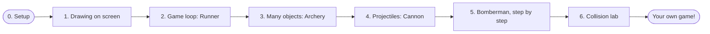

# 🎮 Game Projects: Learn Software Development by Building Games

A hands-on, step-by-step guide to software development in **C++ with the EasyX graphics library**, built from real practice code written for the university course **Practices in Software Development** (2026).

Every lesson is a small, working game or experiment. You read a short explanation, run the code, then change it with guided exercises. By the end you will have built a jumping runner, an archery game, a cannon shooter, the start of a Bomberman clone, and a physics "collision lab".

> **Game = Logic + Data.** The logic is your algorithms and rules; the data is your content and characters. This guide teaches both, one small step at a time.

<p align="center">
  
  
  
</p>

🖼️ **See every game as a picture, with its code, in the [Game Gallery](GALLERY.md).**

---

## 🗺️ The learning path



| # | Lesson | You will learn | Code |
|---|--------|----------------|------|
| 0 | [Setup](docs/setup.md) | Install VS Code + MinGW + EasyX (or Visual Studio 2022) | |
| 1 | [Drawing on screen](lessons/01-drawing-on-screen/) | Window, coordinates, RGB colors, shapes, `Sleep`, first animation | `hello_shapes.cpp` |
| 2 | [Game loop: Runner](lessons/02-game-loop-runner/) | Input → update → draw loop, gravity, box collision, score | `runner_jump.cpp` |
| 3 | [Many objects: Archery](lessons/03-many-objects-archery/) | `struct`, arrays of objects, object pools, circle collision | `balloon_archery.cpp` |
| 4 | [Projectiles: Cannon](lessons/04-projectile-cannon/) | Angles, `sin`/`cos`, velocity vectors, trails, HUD | `cannon_projectile.cpp` |
| 5 | [Bomberman](lessons/05-bomberman/) | Grid maps, 2D arrays, randomness, keyboard control, building a game in stages | `step1…step3` |
| 6 | [Collision lab](lessons/06-collision-lab/) | Closest point, normals, reflection `v' = v − 2(v·n)n`, tunneling and sub-stepping | `triangle_bounce.cpp`, `circle_rect_collision.cpp` |

Each lesson folder contains a `README.md` with:

- **🎯 Goal**: what you will be able to do afterwards
- **▶️ Run it**: how to build and what you should see
- **🧠 Concepts**: the ideas behind the code, with diagrams
- **🔍 Code tour**: where to look in the source file
- **🛠️ Exercises**: three levels (🟢 warm-up, 🟡 challenge, 🔴 boss level)

---

## ⚡ Quick start

1. Follow **[docs/setup.md](docs/setup.md)** once to install the compiler and EasyX.
2. Build and run any lesson from the repository folder:

   ```bat
   build.bat lessons\01-drawing-on-screen\hello_shapes.cpp
   ```

   or open the `.cpp` file in VS Code and press **Ctrl+Shift+B**.

---

## 🧰 Beyond the code: practicing *software development*

Writing a game that works once is programming. Writing it in steps, tracking progress, fixing bugs calmly and explaining your design is **software development**. These pages cover that side:

- **[How to build a game project](docs/software-practices.md)**: roles, the step-by-step development process, planning, version control and the course's evaluation criteria.
- **[The Bug Museum](docs/bug-museum.md)** 🏛️: real bugs (flicker, tunneling, sticking, double-scoring…) found in these practices, and how each one was fixed.
- **[Weekly report template](templates/weekly-report.md)**: the course asks for a weekly progress report in weeks 11 to 15.

---

## 📚 Course map

How this repository lines up with the course schedule:

| Weeks | Course topic | In this repo |
|-------|--------------|--------------|
| 1–4 | Graphics-based rendering (EasyX) | Lessons 1–4 |
| 4–5 | Bomberman, tank battle, collision patterns | Lessons 5–6 |
| 5–8 | Image-based game design | *Coming soon* |
| 9–10 | Python programming | *Coming soon* |
| 11–16 | Weekly reports and final project | [Weekly report template](templates/weekly-report.md) |

Practices from the course that are not in this repo yet (Breakout, "Going down 100 levels", Tank battle) are listed as projects in [docs/software-practices.md](docs/software-practices.md#more-project-ideas-from-the-course). Pull requests welcome!

---

## 📁 Repository layout

```
.
├── README.md                 ← you are here
├── GALLERY.md                ← every game as a picture + code
├── build.bat                 ← one-command build & run (Windows + MinGW)
├── docs/
│   ├── setup.md              ← install the tools
│   ├── software-practices.md ← process, roles, planning, git
│   ├── bug-museum.md         ← bugs and how they were fixed
│   ├── diagrams/             ← SVG figures used in the lessons
│   └── screenshots/          ← pictures of each game
├── lessons/
│   ├── 01-drawing-on-screen/
│   ├── 02-game-loop-runner/
│   ├── 03-many-objects-archery/
│   ├── 04-projectile-cannon/
│   ├── 05-bomberman/
│   └── 06-collision-lab/
├── templates/
│   └── weekly-report.md
└── tools/
    └── easyx-snapshot/       ← makes the screenshots without Windows
```

---

*Code written as practice work for "Practices in Software Development" (Institute of Image and Graphics, 2026). Lecture content is summarized in my own words; the original slides are not included.*
