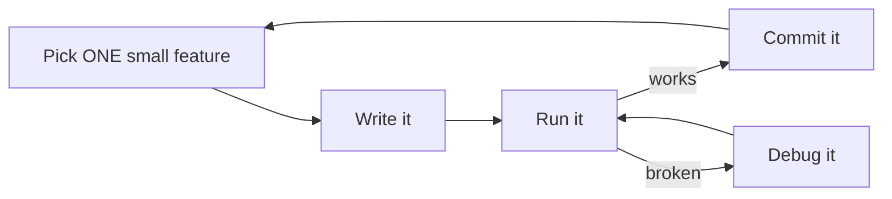

# How to Build a Game Project

The lessons teach you to *program*. This page teaches you to *develop software*: plan it, build it in steps, keep it working, and explain it. It follows the way the course runs a game project from week 1 to the final report.

---

## 1. What a game is made of

> **Game = Logic + Data**

| Part | What it is | Who does it in a real studio | Example from this repo |
|---|---|---|---|
| **Logic** | Core algorithms and rules | Programmer | Gravity, collision, scoring |
| **Data** | Content and characters | Creative planner, artist | Map layout, colors, balloon speeds |
| **Arts** | Images, animations, video | Artist | Shapes now; sprites in weeks 5–8 |
| **Sound** | Music and effects | Sound designer | `Beep(1000, 100)` in the cannon game |

In a student project you play every role. Knowing which hat you are wearing helps: when the game "feels wrong", is it a logic bug or just bad data (a speed that is too high)?

## 2. Knowledge you will use

You do not need all of it on day one, but every item shows up somewhere in a game:

- **Software engineering, data structures, algorithms, logic**: structs, arrays, grids, state flags
- **Graphics, images, human-computer interaction**: drawing, color, keyboard input
- **Math and physics**: coordinates, trigonometry (Lesson 4), vectors and dot products (Lesson 6), gravity

## 3. The step-by-step development process

The single most useful habit: **always have a version that runs.**



[Lesson 5 (Bomberman)](../lessons/05-bomberman/) is a full example: six steps, each a program you can run and show. Notice the empty placeholder functions (`CreateBox()`, `KeyControl()`) in step 1. Sketching the structure first, then filling it in, is a real design technique.

### Write the plan before the code

Before you start, write down in a few lines:

1. **Game rules:** how do you win, how do you lose, how do you score?
2. **Objects:** what things exist (player, enemies, bullets, walls) and what data each one needs?
3. **Steps:** the order you will build things in, smallest first.

This is also exactly what the course evaluates as "clear design and implementation steps".

## 4. Avoiding the common problems

The lecture lists four problems that sink student projects. Here is a remedy for each:

| Problem | Remedy |
|---|---|
| **Unclear design** | Write the 3-part plan above before coding. Draw the screen on paper. |
| **"I don't know how to create pictures"** | Start with shapes (Lessons 1–4 use no image files at all). Swap in images later. |
| **Chaotic progress** | Work in steps, one feature per step, and write a [weekly report](../templates/weekly-report.md). |
| **Too many bugs** | Run after every small change. Keep input/update/draw separate. Visit the [Bug Museum](bug-museum.md). |

And one rule: **make your own game.** Copying a well-known game exactly (the course's example is Flappy Bird) counts as plagiarism. Use classics such as Bomberman or Breakout for inspiration and then add your own twist.

## 5. Version control with Git

Git is your undo button for the whole project and your proof of progress.

```bat
git add lessons\05-bomberman\step4_enemies.cpp
git commit -m "Bomberman: enemies move along lanes"
git push
```

- **Commit after every working step**, with a message that says what now works.
- **Never commit a broken build** to `main`. Try risky ideas on a branch: `git checkout -b try-bombs`.
- Your commit history doubles as material for your weekly reports.

## 6. How the course evaluates a project

| Weight | Item |
|---|---|
| 10% | Attendance |
| 40% | Homework |
| 50% | Final report |

The final project is judged on: clear design and implementation steps, workload and difficulty, weekly reports, and the final result (game rules and scene effects). Every section of this page maps to one of those.

## More project ideas from the course

Practices from the course that are not in this repo yet, good for your own project or for contributing a new lesson:

| Game | Key skills |
|---|---|
| **Breakout** | Generating a wall of bricks with an index array, ball-brick collision, removing bricks, `BeginBatchDraw` |
| **Going down 100 levels** | Randomly generated platforms, character control, landing detection |
| **Tank battle** | Different barrier types, enemy tanks, special skills (e.g. invincibility) for destroying special enemies |
| **Pinball** | Angled bounces: start from [Lesson 6](../lessons/06-collision-lab/) |
| **Running man** | Side-scrolling obstacles: start from [Lesson 2](../lessons/02-game-loop-runner/) |
