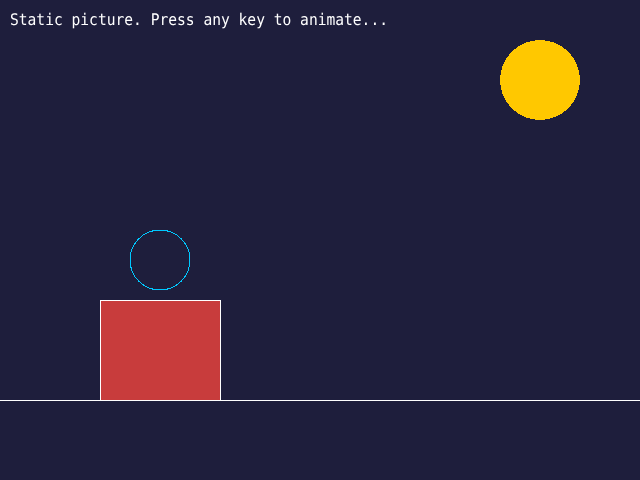
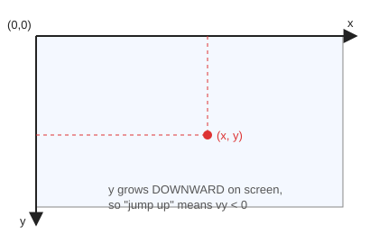
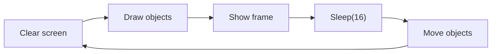

# Lesson 1: Drawing on Screen

> Every game you have ever played is, at its heart, a program that **draws a picture, changes it a little, and draws it again**, many times per second. This lesson teaches the "draw a picture" part.

<p align="center"><br><sub>hello_shapes.cpp, drawn by the real code</sub></p>

## 🎯 Goal

Open a window, understand screen coordinates, mix colors with RGB, draw shapes and text, and make one shape move.

## ▶️ Run it

```bat
build.bat lessons\01-drawing-on-screen\hello_shapes.cpp
```

You should see a night scene with a sun, a house and a circle. Press a key, and a red ball starts bouncing between the walls. Press a key again to quit.

## 🧠 Concepts

### Graphics vs. images

The course separates two kinds of pictures:

| Graphics (vector) | Images (bitmap) |
|---|---|
| Made by **programs** from dots, lines and curves | Captured by **cameras**, made of **pixels** |
| Stay sharp when you zoom in | Become blurry when you zoom in |
| Example: CAD drawings, this lesson | Example: photos, sprites (weeks 5–8) |

In weeks 1–4 every game object is drawn with graphics functions: no image files needed.

### Screen coordinates



The origin `(0, 0)` is the **top-left** corner. `x` grows to the right and `y` grows **downward**. This surprises everyone once: to move something *up*, you *subtract* from `y`.

### The RGB color system

Every color is a mix of **R**ed, **G**reen and **B**lue light, each from 0 to 255.

```cpp
setbkcolor(RGB(0, 0, 0));        // background: black
setlinecolor(RGB(255, 0, 0));    // outlines: red
setfillcolor(RGB(0, 255, 0));    // fills: green
cleardevice();                   // repaint the screen with the background color
```

Other color systems exist (CMYK for printing, YUV for video), but screens use RGB.

### Drawing functions cheat sheet

| Function | Draws |
|---|---|
| `line(x1, y1, x2, y2)` | A line |
| `circle(x, y, r)` | Circle outline |
| `fillcircle(x, y, r)` | Filled circle **with** outline |
| `solidcircle(x, y, r)` | Filled circle, **no** outline |
| `rectangle(l, t, r, b)` / `fillrectangle` / `solidrectangle` | Same idea for rectangles |
| `outtextxy(x, y, text)` | Text |

### From a picture to an animation



`Sleep(ms)` pauses the program for some milliseconds. 16 ms per frame gives about 60 frames per second.

## 🔍 Code tour

| Lines | What happens |
|---|---|
| `initgraph(WIDTH, HEIGHT)` | Creates the window |
| Part A | One static picture, then `_getch()` waits for a key |
| Part B | The animation loop: clear → draw → move → bounce → show → sleep |
| `BeginBatchDraw` / `FlushBatchDraw` | Draws off-screen and shows the whole frame at once, so it does not flicker |

## 🛠️ Exercises

- 🟢 **Warm-up:** Change the colors to make a daytime scene. Add a window and a door to the house.
- 🟡 **Challenge:** Make the ball also move vertically (`vy`) and bounce off all four walls.
- 🔴 **Boss level (course homework 2): gradients.** Draw a background that fades from dark green at the top to bright green at the bottom, and a ball that glows orange in the center and red at the edge.

  <details><summary>💡 Hint</summary>

  A vertical gradient is just many horizontal lines, each a slightly different color:

  ```cpp
  for (int y = 0; y < HEIGHT; y++) {
      int g = 60 + 195 * y / HEIGHT;          // 60 at the top, 255 at the bottom
      setlinecolor(RGB(0, g, 0));
      line(0, y, WIDTH, y);
  }
  ```

  A radial gradient is the same trick with circles: draw filled circles from the biggest radius to the smallest, blending from red to orange.
  </details>

**Next →** [Lesson 2: the game loop](../02-game-loop-runner/)
