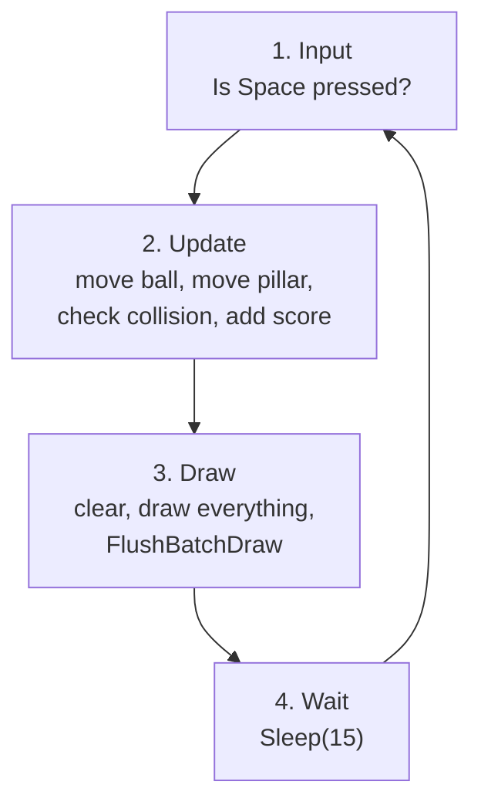

# Lesson 2: The Game Loop (Runner)

> A game is an animation that **listens**. Add input and rules to Lesson 1's loop, and it becomes playable.

<p align="center"><br><sub>runner_jump.cpp, drawn by the real code</sub></p>

## 🎯 Goal

Understand the **game loop**, simulate **gravity**, detect **collisions** between boxes, and keep **score** correctly.

## ▶️ Run it

```bat
build.bat lessons\02-game-loop-runner\runner_jump.cpp
```

A blue square stands on the ground while red pillars of random height rush toward it. Press **Space** to jump. Touch a pillar and it is game over.

## 🧠 Concepts

### The game loop

Almost every game in the world is built on this one loop:



Keep the steps **in this order** and keep them **separate**. When a bug appears, you will know which step to look at.

### Reading the keyboard without stopping the game

`_getch()` waits until a key is pressed, so the whole game freezes. Games use `GetAsyncKeyState` instead, which only asks "is this key down *right now*?":

```cpp
if ((GetAsyncKeyState(VK_SPACE) & 0x8000) && !jumping) { ... }
```

### Gravity in two lines

Position changes by velocity; velocity changes by acceleration. Every frame:

```cpp
y_ball += vy;      // move
vy += gravity;     // fall a little faster
```

A jump is simply `vy = -14` (negative = upward, remember the y-axis from Lesson 1). Gravity pulls it back automatically and the arc comes for free.

### Axis-aligned box collision (AABB)

Two rectangles overlap only if they overlap on **both** axes:

```cpp
bool overlapX = (x_ball + r > x_pillar) && (x_ball - r < x_pillar + pillar_width);
bool overlapY = (y_ball + r > pillar_top);
if (overlapX && overlapY) gameOver = true;
```

### Scoring exactly once

If you add 1 to the score every frame while the pillar is behind the ball, you get +60 per second. The `counted` flag remembers "this pillar already scored" and is reset when a new pillar spawns. This is a tiny **state machine**, a pattern you will use everywhere.

## 🔍 Code tour

| Section in `runner_jump.cpp` | Step of the loop |
|---|---|
| `// ---- Input ----` | Input |
| `// ---- Ball physics ----`, `// ---- Move pillar ----`, `// ---- Score… ----`, `// ---- Collision detection ----` | Update |
| `// ---- Draw ----` | Draw |
| `Sleep(15)` | Wait |

## 🛠️ Exercises

- 🟢 **Warm-up:** Change `gravity` and the jump speed `-14`. What makes the jump feel "floaty"? What makes it feel "snappy"?
- 🟡 **Challenge:** Make the game get harder: every 5 points, increase the minimum pillar speed. Show a "Level" counter next to the score.
- 🔴 **Boss level:** Add a **restart** (press R on the game-over screen) and a **high score** that survives restarts. Bonus: save the high score to a file with `fopen`/`fprintf`.

**Next →** [Lesson 3: many objects at once](../03-many-objects-archery/)
