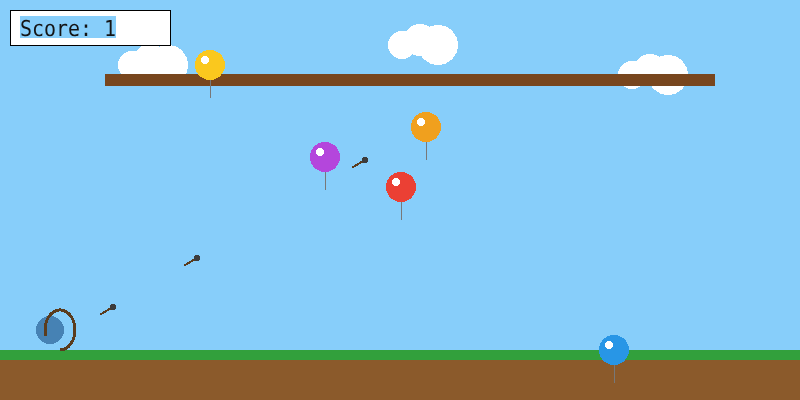
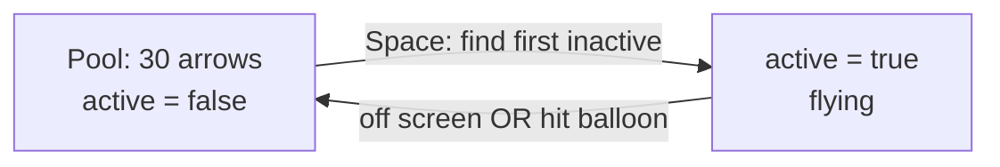

# Lesson 3: Many Objects at Once (Balloon Archery)

> One ball is easy. Thirty arrows and five balloons, all moving at the same time, need **structure**.

<p align="center"><br><sub>balloon_archery.cpp, drawn by the real code</sub></p>

## 🎯 Goal

Group data with `struct`, manage many objects with **arrays**, reuse objects with an **object pool**, detect **circle collisions**, and react to a key **press** instead of a key **hold**.

## ▶️ Run it

```bat
build.bat lessons\03-many-objects-archery\balloon_archery.cpp
```

An archer stands on the left. Balloons float upward, and one golden balloon slides back and forth on a wooden bar. Press **Space** to shoot an arrow, **Esc** to quit.

## 🧠 Concepts

### `struct`: one name for related data

Instead of `arrowX1, arrowY1, arrowX2, …`, describe *one* arrow once:

```cpp
struct Arrow {
    double x, y, vx, vy;
    bool active;
};
Arrow arrows[MAX_ARROWS];
```

Now "move every arrow" is a single `for` loop. This is the first step toward **object-oriented** thinking.

### Object pool: never create, just reuse

The game never creates or deletes arrows while running. It keeps 30 in an array and flips `active`:



Pools are fast and simple, and are used in real games for bullets, particles and enemies.

### Press vs. hold (edge detection)

`GetAsyncKeyState` says the key is down for *every frame* you hold it. Holding Space for half a second would fire 30 arrows. The fix is to compare with the previous frame:

```cpp
bool spaceNow = (GetAsyncKeyState(VK_SPACE) & 0x8000) != 0;
if (spaceNow && !prevSpace) { /* fire once */ }
prevSpace = spaceNow;
```

Only the frame where the key goes from *up* to *down* fires.

### Circle collision

Two circles touch when the distance between their centers is less than the sum of their radii (Pythagoras):

```cpp
double dist = sqrt(dx * dx + dy * dy);
if (dist < balloons[j].r + 4) { /* hit */ }
```

> 💡 Pro tip: compare squared values (`dx*dx + dy*dy < R*R`) to skip the slow `sqrt`.

### Two movement patterns

The same `Balloon` struct supports two behaviours via the `onBar` flag: free balloons rise and respawn at the bottom, the bar balloon patrols left and right. **Data decides behaviour**, which is the *Game = Logic + Data* idea from the course.

## 🔍 Code tour

| Look for | Concept |
|---|---|
| `struct Arrow`, `struct Balloon` | Structs |
| `for (... MAX_ARROWS ...) if (!arrows[i].active)` | Object pool |
| `spaceNow && !prevSpace` | Edge detection |
| Nested loop over arrows × balloons | Collision between two groups |
| `drawClouds()` | Splitting drawing into functions |

## 🛠️ Exercises

- 🟢 **Warm-up:** Give each balloon a random radius, and award more points for small balloons.
- 🟡 **Challenge (spot the bug):** After an arrow hits a balloon it is set to `active = false`, but the inner loop keeps checking the *other* balloons with that same arrow. Can one arrow score twice? Fix it with one line.
- 🔴 **Boss level:** Add a limited quiver (e.g. 20 arrows) and a timer. When either runs out, show a results screen with accuracy = hits ÷ shots.

**Next →** [Lesson 4: projectiles and angles](../04-projectile-cannon/)
