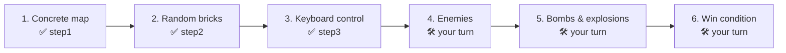
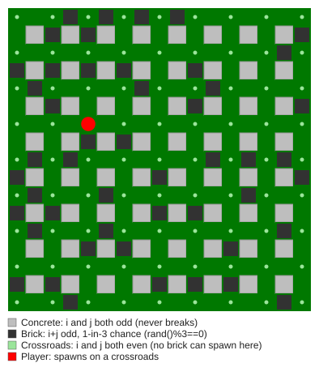

# Lesson 5: Building Bomberman, Step by Step

> Big games are not written in one go. They are built in **small steps that each run**. This lesson shows a real game growing over three files, and gives you the plan to finish it.

| <sub>step 1</sub> | <sub>step 2</sub> | <sub>step 3</sub> |
|---|---|---|
|  |  |  |

## 🎯 Goal

Represent a level as a **grid** (a 2D array), generate it with rules and **randomness**, move a player along lanes with the keyboard, and practice **incremental development**.

## 🧭 The development plan

The course breaks Bomberman into six steps. Each step is a working program you can run and show.



| File | Adds | Run it |
|---|---|---|
| `step1_concrete_map.cpp` | The permanent grey concrete blocks | `build.bat lessons\05-bomberman\step1_concrete_map.cpp` |
| `step2_random_bricks.cpp` | Dark breakable bricks in random places | `build.bat lessons\05-bomberman\step2_random_bricks.cpp` |
| `step3_player_control.cpp` | A red ball (the player) moved with the arrow keys, inside a game loop | `build.bat lessons\05-bomberman\step3_player_control.cpp` |

Open the files side by side and compare them. Each one keeps everything from the step before and adds **one** new idea. Notice how step 1 already had empty `CreateBox()` and `KeyControl()` functions as **placeholders**: the plan is visible in the code before it is implemented.

## 🧠 Concepts

### The map is a grid

The window is 850 × 850 pixels, split into 17 × 17 cells of 50 × 50. Cell `(i, j)` covers pixels `i*50 … i*50+50` horizontally and `j*50 … j*50+50` vertically.



Three simple rules with `%` (remainder) generate the whole level:

| Rule | Meaning | Code |
|---|---|---|
| `i` odd **and** `j` odd | Concrete block (permanent) | `i % 2 != 0 && j % 2 != 0` |
| `i + j` odd | Could be a brick, with 1-in-3 chance | `(i+j) % 2 != 0 && rand() % 3 == 0` |
| `i` even **and** `j` even | Crossroads: always free | (falls out of the other two rules) |

That gives 9 horizontal and 9 vertical lanes separated by 8 rows of blocks, exactly the "9 lanes + 8 blocks" layout from the lecture.

### Why the player never spawns inside a brick

The player's start is `x = rand() % 9 * 100 + 25`, which is always the **center of an even cell** (25, 125, 225, …). Even + even = even, so `(i + j) % 2 != 0` is false there and no brick can ever appear on a crossroads. A tiny bit of math replaces an "is this spot free?" check.

### Storing the level: `bool Box[17][17]`

Drawing and logic both read the same 2D array. That separation (data in an array, rules in functions) means later steps such as "a bomb destroys bricks" become `Box[i][j] = false;`.

### Moving only along lanes

```cpp
if (GetAsyncKeyState(VK_UP) && ((x - 25) % 100 == 0))   // only on a vertical lane
```

The player may move vertically only when its `x` is exactly on a lane center, and horizontally only when its `y` is. This works because `speed = 5` divides 100 evenly, so the player always lands exactly on lane centers. Change speed to 7 and see what happens!

### Pixel ↔ cell conversion

You will need this for every remaining step:

```cpp
int i = x / 50;   // which column the player is in
int j = y / 50;   // which row
```

## 🔍 Code tour (step 3)

| Function | Role |
|---|---|
| `CreateBox()` | Fills `Box[][]` once at start (**data**) |
| `DrawMap()` | Draws concrete + bricks from the rules and `Box[][]` (**draw**) |
| `KeyControl()` | Moves the player along lanes (**input + update**) |
| `main()` loop | Draw → read keys → draw player → flush → `Sleep(100)` → clear |

## 🛠️ Exercises (the rest of the game)

These are the course's Bomberman homework, in order:

- 🟢 **Brick collision:** In step 3 the player walks straight through bricks. Before moving, compute the cell you would enter and refuse the move if `Box[i][j]` is true.
- 🟢 **Smoother play:** `Sleep(100)` gives 10 frames per second. Try `Sleep(20)`. What else must change so the player does not become too fast?
- 🟡 **Enemies:** Add a `struct Enemy { int x, y, dx, dy; };` array. Spawn enemies on random crossroads, move them along lanes, and turn them around at walls.
- 🟡 **Bombs:** Space places a bomb at the player's cell. After a countdown it explodes in a **+** shape: the flames stop at concrete, destroy the first brick they reach, and defeat enemies.
- 🔴 **Win condition:** Clear the level by defeating all enemies, **or** by finding a hidden key under one of the bricks.
- 🔴 **Advanced (course bonus):** Destroyed bricks sometimes drop **gift bags** with power-ups: longer flames, more bombs, faster speed.

> 💡 **Process tip:** Do one exercise, run it, commit it (`git commit -m "Bomberman: brick collision"`), then start the next. If step 5 breaks everything, you can always go back to step 4.

**Next →** [Lesson 6: the collision lab](../06-collision-lab/)
