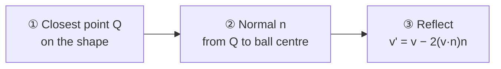
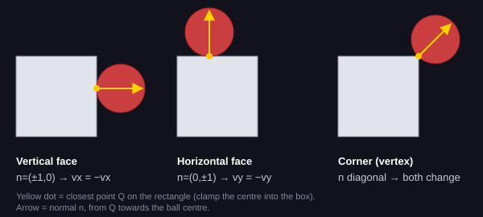
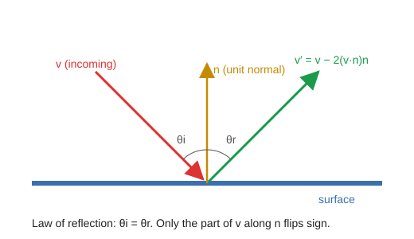

# Lesson 6: The Collision Lab

> "Did it hit?" is easy. "Where did it hit, and which way should it bounce?" is where game programming meets geometry. These two programs are **experiments**: they draw the normal, the velocity and the angles live so you can *watch* the math work.

| <sub>triangle_bounce.cpp</sub> | <sub>circle_rect_collision.cpp</sub> |
|---|---|
|  |  |

## 🎯 Goal

Find the **closest point** on a shape, compute the surface **normal**, reflect a velocity with **v' = v − 2(v·n)n**, and understand two classic physics bugs: **sticking** and **tunneling**.

## ▶️ Run it

```bat
build.bat lessons\06-collision-lab\triangle_bounce.cpp
build.bat lessons\06-collision-lab\circle_rect_collision.cpp
```

| Program | What you see | Keys |
|---|---|---|
| `triangle_bounce.cpp` | A ball falls on a blue triangle and bounces off its slopes. Yellow line = velocity. The incidence/reflection angles are printed. | R restart, Esc quit |
| `circle_rect_collision.cpp` | A ball flies around four boxes. On each hit, the contact point and normal flash, and the hit type is shown: **vertical face**, **horizontal face** or **corner**. | Space pause, R restart, Esc quit |

## 🧠 Concepts

### The 3-step recipe (from the lecture)

Every circle-vs-shape bounce in both programs follows the same three steps:



### ① Closest point

**On a line segment AB** (triangle edges): project P onto the line and clamp to the segment.

```
t = ((P − A) · (B − A)) / |B − A|²      clamp t to [0, 1]
Q = A + t · (B − A)
```

Clamping matters: without it you get the closest point on an *infinite* line, and the ball would bounce off empty air past the triangle's corners.

**On a rectangle** (axis-aligned): just clamp the center into the box.

```cpp
qx = clamp(px, rc.left, rc.right);
qy = clamp(py, rc.top,  rc.bottom);
```

If the ball center is closer than its radius to Q, it is a collision.

### ② The normal tells you the hit type



| Hit | Normal n | Bounce simplifies to |
|---|---|---|
| Vertical face | (±1, 0) | `vx = -vx` |
| Horizontal face | (0, ±1) | `vy = -vy` |
| Corner | diagonal | both change, by the general formula |

The simple `vx = -vx` trick from Breakout-style games is just the special case of the general formula. Corners are where the simple trick breaks, which is why the program detects them separately (`HIT_CORNER`).

### ③ Reflection



Split the velocity into a part **along the normal** (`vn = v · n`) and a part **along the surface**. Bouncing flips only the normal part:

```cpp
float vn = vx * nx + vy * ny;   // dot product
if (vn < 0) {                   // only if moving INTO the surface
    vx -= 2 * vn * nx;
    vy -= 2 * vn * ny;
}
```

Angle of incidence = angle of reflection, measured from the normal: `θ = atan2(|tangential|, |vn|)`. The programs print both so you can verify the law yourself.

`triangle_bounce.cpp` also multiplies by `BOUNCE_DAMP = 0.85` so each bounce loses 15% of its speed, like a real ball.

### Two bugs every physics programmer meets

| Bug | Symptom | Fix used here |
|---|---|---|
| **Sticking** | Ball gets inside the surface, reflects, is still inside next frame, reflects back… and jitters forever | Only reflect when `vn < 0`, then **push the ball out** to exactly radius distance: `b.x = qx + nx * BALL_R` |
| **Tunneling** | A fast ball jumps from one side of a thin wall to the other in one frame and never "touches" it | **Sub-stepping**: split each frame's motion into small steps no longer than 0.4 × radius and check collisions after each one (`UpdateBall()` in `circle_rect_collision.cpp`) |

### Point in triangle

`triangle_bounce.cpp` also handles the case where the ball center is already *inside* the triangle, using the **cross-product sign test**: P is inside if it is on the same side of all three edges.

## 🔍 Code tour

| Function | File | Step |
|---|---|---|
| `ClosestPointOnSeg` | triangle | ① |
| `PointInTriangle`, `Cross2D` | triangle | inside test |
| `GetContactNormal` | triangle | ② |
| `ClosestPointOnRect` | circle-rect | ① |
| `CollideCircleRect` | circle-rect | ① ② ③ + hit type |
| `UpdateBall` | circle-rect | sub-stepping |

## 🛠️ Exercises

- 🟢 **Warm-up:** Set `BOUNCE_DAMP` to `1.0` and then `0.5`. Describe the difference. Change `START_X` so the ball lands exactly on the triangle's peak.
- 🟡 **Challenge:** Remove sub-stepping (set `steps = 1`) and raise `BALL_SPEED` to 40. Watch the ball tunnel through boxes. Put it back and confirm the fix.
- 🔴 **Boss level:** Combine this with Lesson 5: give Bomberman's map a ball that bounces off concrete blocks using `CollideCircleRect`. Or build a mini **pinball** table (one of the course's recommended games) from triangles and rectangles.

---

🎉 **You finished the path!** Head to [How to build a game project](../../docs/software-practices.md) to plan your own game.
