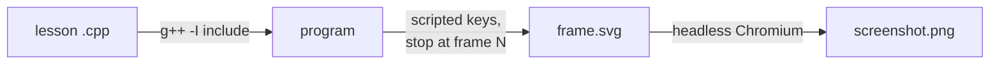

# easyx-snapshot: pictures of EasyX games without Windows

EasyX only runs on Windows, but the pictures in the [Game Gallery](../../GALLERY.md) were made on Linux, from the **unchanged** lesson code.

## How it works

`include/emu.h` is a tiny stand-in for EasyX. It has the same function names (`initgraph`, `fillcircle`, `outtextxy`, `GetAsyncKeyState`, …), but instead of painting a window each call adds one shape to an SVG picture. The fake `graphics.h`, `conio.h` and `windows.h` in `include/` all just include `emu.h`, so the compiler picks them up instead of the real ones.



Each run is controlled with environment variables:

| Variable | Meaning | Example |
|---|---|---|
| `KEYS` | Keys held during frame ranges | `SPACE:98-98,LEFT:1-10` |
| `SNAP` | Save the picture at this `FlushBatchDraw()` frame | `124` |
| `GETCH_SNAP` | Save the picture at the Nth `_getch()` (for programs with no loop) | `1` |
| `SEED` | Replaces the seed passed to `srand`, so random levels are repeatable | `3` |

This is also a small lesson in itself: **a well-defined interface (the EasyX API) can be swapped for a different implementation** without touching the code that uses it. Testing tools often work exactly like this.

## Regenerate the screenshots

On Linux or macOS with `g++`, Python 3 + Pillow, and Chromium:

```bash
CHROMIUM=/path/to/chromium tools/easyx-snapshot/snapshot.sh
```

The exact frame and keys for each picture are listed at the bottom of [`snapshot.sh`](snapshot.sh). Change them to capture a different moment.

## Limits

It draws shapes and text only (no images, no sound), and text is in a monospace font, so letter widths may differ slightly from the real Windows window.
